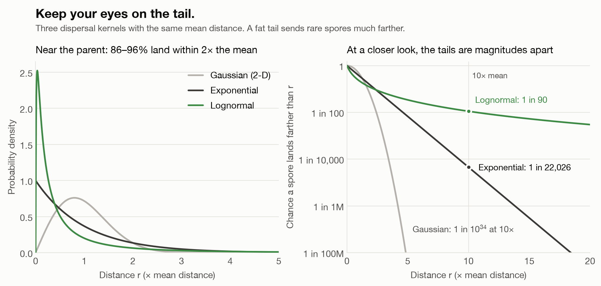
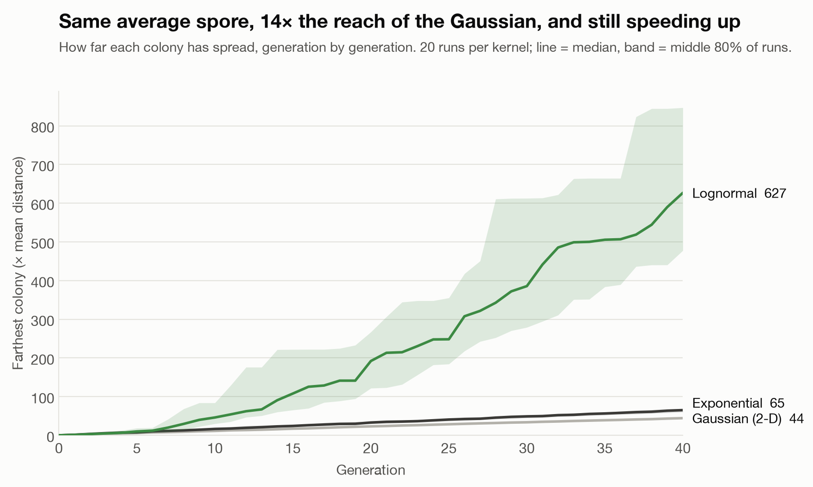
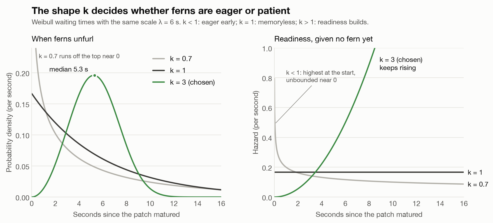

# moss

This is just a pixel moss, that grows with an interesting distribution, real-life ecology.

**Full analysis:** [notebook/moss.ipynb](notebook/moss.ipynb)

## The question

Why does moss spread faster than predicted by an average/normal distribution?
Reid's paradox talks about this - why did oak spread so rapidly after the last ice age? 


## Two distributions

### 1. Where spores land: a fat-tailed dispersal kernel

A dispersal kernel is just PDF(distance travelled by spores).
I think a lognormal distribution explains the answer to Reid's paradox well due to its heavy tail.



Every kernel moves an average spore the same distance, but after 40 generations the lognormal colony reaches 14× farther than the Gaussian one.




### 2. When ferns rise: Weibull germination times

Once a patch of moss is mature and left undisturbed, a fern eventually rises out of it. How long that takes is random.
The Weibull distribution is a natural fit: it's a standard model for time-to-event data like germination, because one parameter, the shape $k$, sets how the chance of the event changes as you wait.

- $k < 1$: most likely early, then less and less likely
- $k = 1$: the same chance every second (the exponential, which has no memory)
- $k > 1$: the longer you wait, the readier it gets

I use $k = 3$ and $\lambda = 6$ s, so ferns rise from moss that's been left alone: the median wait is about 5.3 s, and 90% of ferns unfurl between 2.2 and 8.6 s. (I started with $\lambda = 12$ s, but on the page the first fern took too long to show up.)

The same distribution, with $k = 2$, also times when spores land somewhere new and start a fresh patch.



## How it fits together

How the garden on my homepage grows:

1. **New patches start.** Every so often, after a Weibull-distributed wait, a spore lands somewhere new. Parts of the page further down only wake up once they've been scrolled into view, so you see them begin.
2. **Spores spread.** Every bit of moss keeps releasing spores, and how far each one flies is drawn from the lognormal kernel. Most land close by, and a few land far away.
3. **Only damp ground holds them.** A spore takes root only where a hidden habitat map (smooth random noise, like damp and dry ground) says it can. So the moss grows as a carpet with fingers and gaps rather than in circles. The habitat decides *whether* a spore takes root; how far it travelled always comes from the kernel.
4. **Ferns rise.** When moss has settled and nobody has disturbed it, it waits a Weibull-distributed time and then a fern unfurls. New ferns tend to come up near existing ones, so they gather in small groups.

So the lognormal decides *where* spores land, the habitat decides *whether* they take, and the Weibull decides *when* new patches and ferns appear. The cursor can clear moss, curl ferns away and make the creepers fold up, but that's interaction, not part of the model.

## Repo layout

| Path | What it is |
| --- | --- |
| `notebook/moss.ipynb` | The analysis: sampling, plots, the spread comparison, parameter choices. |
| `notebook/figures/` | The figures, as PNGs. |
| `notebook/requirements.txt` | Python dependencies for the notebook. |

The homepage's own implementation is [`moss.js`](https://github.com/PrithviHegde/PrithviHegde.github.io/blob/main/moss.js) in the site's repo.

## Running the notebook

```bash
python3 -m venv .venv && source .venv/bin/activate
pip install -r notebook/requirements.txt
jupyter lab notebook/moss.ipynb
```

## References

- Clark, J. S. (1998). Why trees migrate so fast: confronting theory with dispersal biology and the paleorecord. *The American Naturalist*, 152(2), 204–224.
