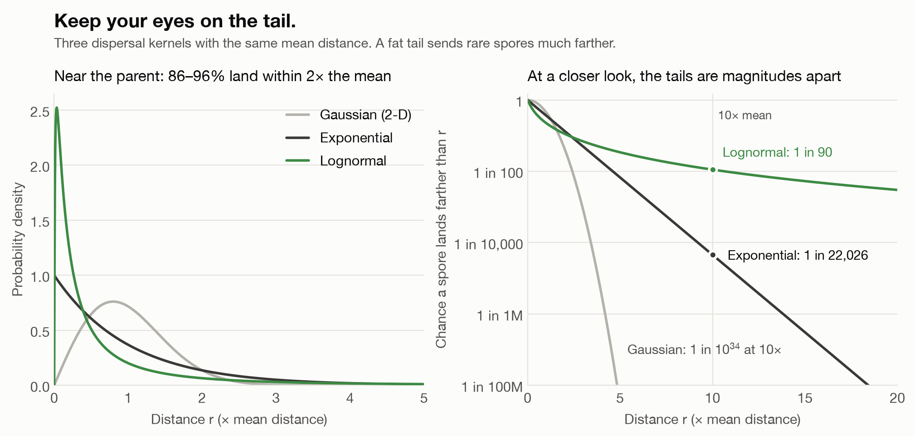
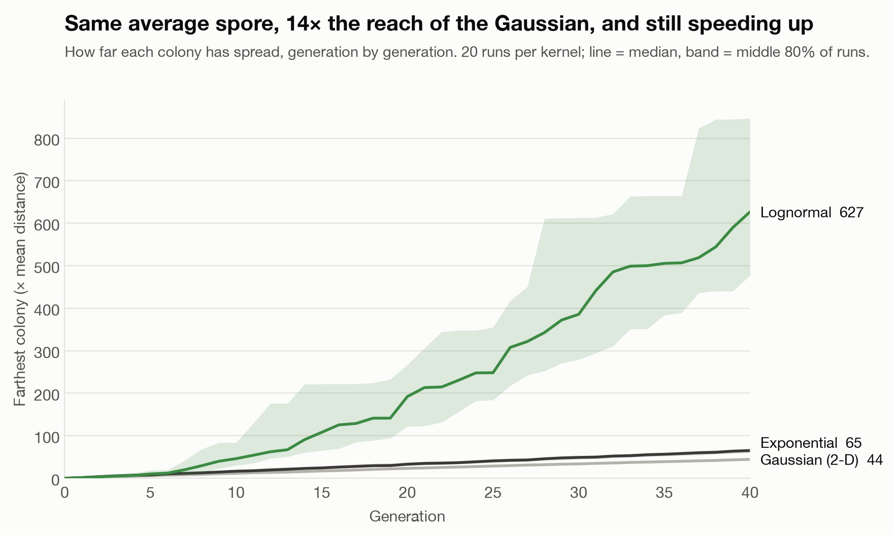
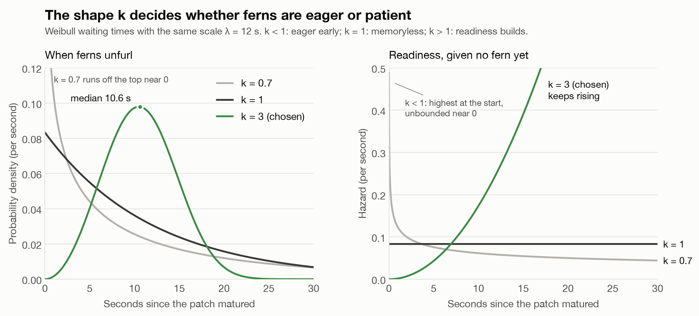

# moss

This is just a pixel moss, that grows with an interesting distribution, real-life ecology.

**Full analysis:** [notebook/moss.ipynb](notebook/moss.ipynb)

## The question

why does moss spread faster than predicted by an average/normal distribution?
Reid's paradox talks about this - why did oak spread so rapidly after the last ice age? 


## Two distributions

### 1. Where spores land: a fat-tailed dispersal kernel

a dispersal kernel is just PDF(distance travelled by spores).
I think a lognormal distribution explains the answer to Reid's paradox well due to its heavy tail.



every kernel moves an average spore the same distance, but after 40 generations the lognormal colony reaches 14× farther than the Gaussian one.




### 2. When ferns rise: Weibull germination times

once a patch of moss is mature and left undisturbed, a fern eventually rises out of it. How long that takes is random.
the Weibull distribution is a natural fit: it's a standard model for time-to-event data like germination, because one parameter, the shape $k$, sets how the chance of the event changes as you wait.

- $k < 1$: most likely early, then less and less likely
- $k = 1$: the same chance every second (the exponential, which has no memory)
- $k > 1$: the longer you wait, the readier it gets

I use $k = 3$ and $\lambda = 12$ s, so ferns come to visitors who stay still: the median wait is about 10.6 s, and 90% of ferns unfurl between 4.5 and 17.3 s.



## How it fits together

The life of one patch on the page:

1. **Spores land.** Each mature patch releases spores, and how far each one flies is drawn from the lognormal kernel. Most land close by, and a few land far away.
2. **Moss spreads.** Spores that land on bare ground grow into new moss. Because of the fat tail, the moss doesn't just creep outward; it starts outposts far ahead.
3. **Ferns rise.** When a patch has matured and nobody has disturbed it, it waits a Weibull-distributed time and then a fern unfurls.

So the lognormal decides *where* things grow, and the Weibull decides *when* the ferns appear.

## Repo layout

| Path | What it is |
| --- | --- |
| `notebook/moss.ipynb` | The analysis: sampling, plots, the spread comparison, parameter choices. |
| `notebook/figures/` | The figures, as PNGs. |
| `notebook/requirements.txt` | Python dependencies for the notebook. |

## Running the notebook

```bash
python3 -m venv .venv && source .venv/bin/activate
pip install -r notebook/requirements.txt
jupyter lab notebook/moss.ipynb
```

## References

- Clark, J. S. (1998). Why trees migrate so fast: confronting theory with dispersal biology and the paleorecord. *The American Naturalist*, 152(2), 204–224.
